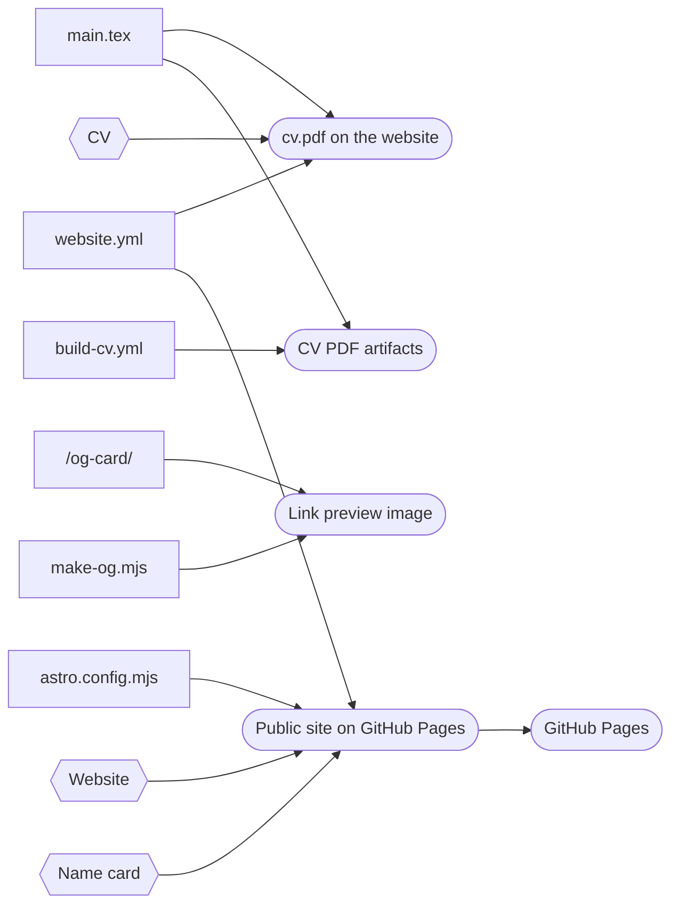
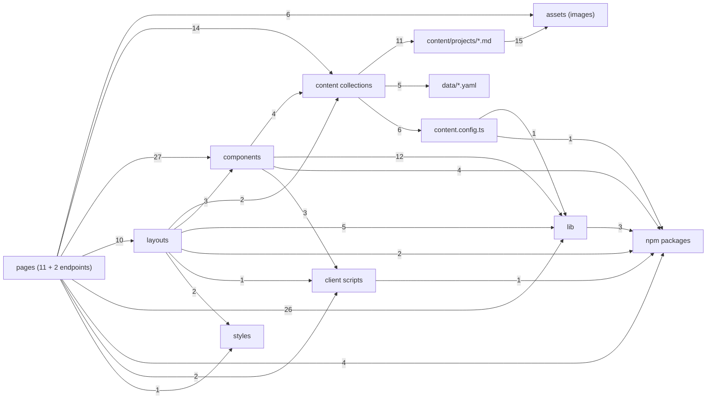

# Knowledge graph

<!-- Generated by scripts/graph.mjs. Do not edit by hand: change the code, the docs or docs/graph/curated.mjs, then run node scripts/graph.mjs. -->

A map of the whole portfolio (website, CV, name card, docs, CI) as nodes and edges. It lets a person or an agent answer "what does this file touch, what touches it, which doc explains it and which rule applies" without opening the code. Most of it is extracted from the repository; [curated.mjs](curated.mjs) adds products, outputs, rules, decisions and sync links.

## Use it

```bash
node scripts/graph.mjs query website/src/lib/qr.ts      # neighbours, docs, rules, sync partners
node scripts/graph.mjs query collection:profile         # any node id works too
node scripts/graph.mjs impact website/src/data/profile.yaml   # routes and outputs affected
node scripts/graph.mjs                                  # regenerate after changes
node scripts/graph.mjs --check                          # what CI runs
grep '"website/src/lib/url.ts"' docs/graph/graph.json   # raw lines, one node or edge each
```

## Contents

| Node type | Count |
|---|---|
| `doc` | 31 |
| `route` | 23 |
| `dir` | 20 |
| `asset` | 18 |
| `decision` | 14 |
| `component` | 14 |
| `content` | 11 |
| `page` | 11 |
| `rule` | 10 |
| `latex` | 8 |
| `config` | 7 |
| `lib` | 7 |
| `collection` | 6 |
| `tool` | 6 |
| `package` | 5 |
| `data` | 5 |
| `output` | 4 |
| `product` | 4 |
| `client-script` | 4 |
| `workflow` | 3 |
| `layout` | 2 |
| `endpoint` | 2 |
| `graph-data` | 1 |
| `host` | 1 |
| `schema` | 1 |
| `style` | 1 |
| `test` | 1 |

| Edge type | Count | Meaning |
|---|---|---|
| `imports` | 127 | Code import (file or npm package) |
| `links` | 116 | Doc links to a file or folder |
| `documents` | 73 | Doc explains a file or folder (front matter covers) |
| `built_from` | 31 | Output made from a source |
| `governs` | 26 | Rule applies to a path |
| `affects` | 24 | Decision shaped a path |
| `explained_in` | 24 | Rule or decision is explained in a doc |
| `renders` | 23 | Page or endpoint produces a route |
| `uses_asset` | 21 | Uses an image |
| `reads` | 20 | Code reads a content collection |
| `loads` | 16 | Collection loads a data or content file |
| `tests` | 13 | Test visits a route |
| `feeds` | 11 | Project file supplies a project route |
| `syncs_with` | 11 | Same facts in two files that do not read each other |
| `superseded_by` | 8 | History doc replaced by a reference doc |
| `inputs` | 7 | LaTeX \input |
| `defined_in` | 6 | Collection schema location |
| `provides` | 6 | Content library wraps a collection in a getter |

## Coverage

84 of 84 code, data, config and CI files are explained by a reference doc (front matter `covers`). `--check` fails on any file that is not.

## Products and outputs



## Website modules

By folder. Numbers count the edges (imports, collection reads and loads, image uses) between folders. Use `query` for the files behind an arrow.



File by file: [modules.md](modules.md) (large). In Obsidian, [portfolio.canvas](portfolio.canvas) shows the documentation map on a canvas.

## Which doc explains what

| Doc | Type | Covers |
|---|---|---|
| [docs/card/reference.md](../card/reference.md) | reference | `website/src/layouts/Bare.astro`, `website/src/lib/qr.ts`, `website/src/pages/card-qr.svg.ts`, `website/src/pages/card/`, `website/src/pages/devin-ezekiel-purba.vcf.ts` |
| [docs/cv/reference.md](../cv/reference.md) | reference | `.github/workflows/build-cv.yml`, `cv/` |
| [docs/graph/modules.md](modules.md) | index |  |
| [docs/graph/README.md](README.md) | index | `docs/graph/curated.mjs`, `scripts/graph.mjs` |
| [docs/project/architecture.md](../project/architecture.md) | reference | `.github/workflows/build-cv.yml`, `.github/workflows/docs.yml`, `.github/workflows/website.yml`, `.gitignore`, `cv/main.tex`, `website/astro.config.mjs`, `website/package.json` |
| [docs/project/decisions.md](../project/decisions.md) | reference | `docs/card/01-research.md`, `docs/website/04-framework-research.md`, `docs/website/05-visual-direction.md`, `docs/website/07-v5-plan.md` |
| [docs/project/environments.md](../project/environments.md) | reference | `website/package.json`, `website/playwright.config.ts`, `website/scripts/shots.mjs` |
| [docs/project/obsidian.md](../project/obsidian.md) | reference | `.gitignore`, `docs/Docs.base`, `scripts/obsidian-setup.mjs` |
| [docs/project/overview.md](../project/overview.md) | reference | `README.md` |
| [docs/project/publishing-rules.md](../project/publishing-rules.md) | reference | `cv/professional_experience.tex`, `website/scripts/figures.mjs`, `website/src/assets/projects/`, `website/src/content/projects/` |
| [docs/project/runbooks.md](../project/runbooks.md) | runbook | `cv/`, `scripts/graph.mjs`, `website/README.md`, `website/scripts/`, `website/src/content/projects/`, `website/src/data/` |
| [docs/project/sources-of-truth.md](../project/sources-of-truth.md) | reference | `cv/certification.tex`, `cv/config.sty`, `cv/education.tex`, `cv/professional_experience.tex`, `cv/projects.tex`, `cv/skills.tex`, `cv/title.tex`, `website/public/og.jpg`, `website/src/content/projects/`, `website/src/data/` |
| [docs/README.md](../README.md) | index | `docs/` |
| [docs/website/architecture.md](../website/architecture.md) | reference | `website/astro.config.mjs`, `website/src/components/`, `website/src/layouts/`, `website/src/lib/`, `website/src/pages/`, `website/src/scripts/`, `website/src/styles/global.css`, `website/tsconfig.json` |
| [docs/website/content-model.md](../website/content-model.md) | reference | `website/src/content.config.ts`, `website/src/content/projects/`, `website/src/data/`, `website/src/lib/content.ts`, `website/src/lib/glossary.ts`, `website/src/lib/themes.ts` |
| [docs/website/design-system.md](../website/design-system.md) | reference | `website/astro.config.mjs`, `website/src/lib/themes.ts`, `website/src/lib/transitions.ts`, `website/src/styles/global.css` |
| [docs/website/quality.md](../website/quality.md) | reference | `.github/workflows/website.yml`, `website/playwright.config.ts`, `website/scripts/figures.mjs`, `website/scripts/make-og.mjs`, `website/scripts/measure.mjs`, `website/scripts/shots.mjs`, `website/tests/site.spec.ts` |

## Facts kept in two places

| File | Must match | What |
|---|---|---|
| `cv/config.sty` | `.github/workflows/build-cv.yml` | emails the ATS check expects |
| `website/src/content/projects/` | `cv/professional_experience.tex` | client case-study facts used in CV bullets |
| `website/src/content/projects/` | `cv/projects.tex` | three academic projects |
| `website/src/data/certifications.yaml` | `cv/certification.tex` | seven certificates and dates |
| `website/src/data/education.yaml` | `cv/education.tex` | degree, GPA, thesis, exchange |
| `website/src/data/experience.yaml` | `cv/professional_experience.tex` | roles, orgs, places, dates (CV has STAR detail) |
| `website/src/data/experience.yaml` | `website/tests/site.spec.ts` | test expects the current job title on Experience |
| `website/src/data/profile.yaml` | `cv/config.sty` | email (CV holds personal and work addresses) |
| `website/src/data/profile.yaml` | `cv/title.tex` | name, city, phone, LinkedIn, GitHub, summary and current role |
| `website/src/data/profile.yaml` | `website/src/components/Header.astro` | brand name hard-coded in the header |
| `website/src/data/skills.yaml` | `cv/skills.tex` | skills (levels on the site, lists on the CV) |

## Rules

| Rule | Says | Governs |
|---|---|---|
| No names, places, codes | No client, plant, vendor, grid operator, market body or place names, project codes or internal model names (D1, D7, D10) | `website/src/content/projects/`, `website/src/assets/projects/`, `cv/`, `docs/` |
| Approximate ratings, no algorithms | Approximate or class ratings for every plant; methods at block level only (D7) | `website/src/content/projects/`, `website/src/assets/projects/`, `cv/professional_experience.tex` |
| Facts come from Devin | Never invent roles, dates or numbers; role lines are Devin's words (D4) | `website/src/content/projects/`, `website/src/data/`, `cv/` |
| Employer only in job history | Employer named on Experience, About role line, CV and name card; never in case studies (D5) | `website/src/data/profile.yaml`, `website/src/data/experience.yaml`, `website/src/content/projects/`, `cv/professional_experience.tex` |
| Figures carry pixels only | PNG only, metadata stripped by figures.mjs --fix; npm run check fails otherwise | `website/src/assets/projects/`, `website/scripts/figures.mjs` |
| CV: two pages, STAR, ATS | Two pages, STAR bullets, extractable text; shorten bullets instead of shrinking layout | `cv/` |
| Base-aware links | Build every internal link with url() from src/lib/url.ts | `website/src/` |
| Colour tokens only | Use CSS variables from global.css, not literal colours (print and card pages excepted) | `website/src/` |
| Respect reduced motion | Every animation stops under prefers-reduced-motion | `website/src/styles/global.css`, `website/src/scripts/`, `website/src/components/` |
| Plain English, no em dashes | Short sentences, numbers with units, no marketing words, no em dashes; acronyms in glossary.ts | `website/src/content/`, `website/src/data/`, `cv/`, `docs/` |
