# Website module diagram

<!-- Generated by scripts/graph.mjs. Do not edit by hand. -->

Every file in `website/src` and its imports. Solid arrows are imports; dotted arrows show files reading content collections and the data files behind them. The folder-level view is in [the knowledge graph](README.md#website-modules).

```mermaid
%%{init: {"theme": "base", "themeVariables": {"fontSize": "14px", "primaryColor": "#ffffff", "primaryTextColor": "#12161c", "primaryBorderColor": "#12161c", "lineColor": "#4c5866", "secondaryColor": "#f3f5f7", "tertiaryColor": "#f3f5f7", "clusterBkg": "#f3f5f7", "clusterBorder": "#aeb8c3", "edgeLabelBackground": "#f3f5f7"}}}%%
flowchart LR
  classDef code fill:#e1eaf8,stroke:#1d5fc4,color:#12161c
  classDef data fill:#d9f0ec,stroke:#0e8f7e,color:#12161c
  classDef out fill:#fbf1cf,stroke:#8a6300,color:#12161c
  classDef prod fill:#12161c,stroke:#12161c,color:#ffffff
  classDef ext fill:#ffffff,stroke:#aeb8c3,color:#4c5866
  subgraph pages
    n14["404.astro"]:::code
    n15["about.astro"]:::code
    n16["card-qr.svg.ts"]:::code
    n17["card/index.astro"]:::code
    n18["card/print.astro"]:::code
    n19["devin-ezekiel-purba.vcf.ts"]:::code
    n20["education.astro"]:::code
    n21["experience.astro"]:::code
    n22["index.astro"]:::code
    n23["og-card.astro"]:::code
    n24["projects/[slug].astro"]:::code
    n25["projects/index.astro"]:::code
    n26["skills.astro"]:::code
  end
  subgraph layouts
    n27["Bare.astro"]:::code
    n28["Base.astro"]:::code
  end
  subgraph components
    n29["CommandPalette.astro"]:::code
    n30["Footer.astro"]:::code
    n31["Gantt.astro"]:::code
    n32["Header.astro"]:::code
    n33["Icon.astro"]:::code
    n34["Instrument.astro"]:::code
    n35["PageHead.astro"]:::code
    n36["Photo.astro"]:::code
    n37["ProjectArt.astro"]:::code
    n38["ProjectCard.astro"]:::code
    n39["ProjectCover.astro"]:::code
    n40["Schematic.astro"]:::code
    n41["SectionHead.astro"]:::code
    n42["Timeline.astro"]:::code
  end
  subgraph lib
    n43["content.ts"]:::code
    n44["dates.ts"]:::code
    n45["glossary.ts"]:::code
    n46["qr.ts"]:::code
    n47["themes.ts"]:::code
    n48["transitions.ts"]:::code
    n49["url.ts"]:::code
  end
  subgraph scripts
    n50["cmdk.ts"]:::code
    n51["filters.ts"]:::code
    n52["instrument.ts"]:::code
    n53["shell.ts"]:::code
  end
  subgraph styles
    n54["global.css"]:::code
  end
  n55["content.config.ts"]:::data
  n56[("certifications.yaml")]:::data
  n57[("education.yaml")]:::data
  n58[("experience.yaml")]:::data
  n59[("profile.yaml")]:::data
  n60[("skills.yaml")]:::data
  n61[("projects/*.md")]:::data
  n29 --> n33
  n29 --> n43
  n29 --> n49
  n29 --> n50
  n30 --> n33
  n30 --> n44
  n30 --> n49
  n31 --> n44
  n32 --> n33
  n32 --> n49
  n34 --> n33
  n34 --> n52
  n35 --> n40
  n37 --> n47
  n38 --> n39
  n38 --> n43
  n38 --> n44
  n38 --> n49
  n39 --> n37
  n39 --> n47
  n42 --> n49
  n42 --> n51
  n55 --> n47
  n27 --> n43
  n27 --> n49
  n27 --> n54
  n28 --> n29
  n28 --> n30
  n28 --> n32
  n28 --> n43
  n28 --> n48
  n28 --> n49
  n28 --> n53
  n28 --> n54
  n43 --> n44
  n43 --> n47
  n46 --> n49
  n14 --> n28
  n14 --> n49
  n15 --> n33
  n15 --> n35
  n15 --> n36
  n15 --> n28
  n15 --> n43
  n15 --> n44
  n15 --> n49
  n15 --> n53
  n16 --> n46
  n17 --> n33
  n17 --> n36
  n17 --> n27
  n17 --> n43
  n17 --> n46
  n17 --> n49
  n18 --> n27
  n18 --> n43
  n18 --> n46
  n19 --> n43
  n19 --> n49
  n20 --> n35
  n20 --> n36
  n20 --> n41
  n20 --> n42
  n20 --> n28
  n20 --> n43
  n20 --> n44
  n21 --> n31
  n21 --> n35
  n21 --> n41
  n21 --> n42
  n21 --> n28
  n21 --> n43
  n21 --> n44
  n22 --> n33
  n22 --> n34
  n22 --> n36
  n22 --> n38
  n22 --> n40
  n22 --> n41
  n22 --> n28
  n22 --> n43
  n22 --> n49
  n23 --> n43
  n23 --> n54
  n24 --> n33
  n24 --> n39
  n24 --> n40
  n24 --> n28
  n24 --> n43
  n24 --> n44
  n24 --> n45
  n24 --> n49
  n25 --> n35
  n25 --> n38
  n25 --> n28
  n25 --> n43
  n25 --> n51
  n26 --> n33
  n26 --> n35
  n26 --> n41
  n26 --> n28
  n26 --> n43
  n26 --> n44
  n50 --> n53
  n29 -.-> n55
  n27 -.-> n55
  n28 -.-> n55
  n15 -.-> n55
  n17 -.-> n55
  n18 -.-> n55
  n19 -.-> n55
  n20 -.-> n55
  n21 -.-> n55
  n22 -.-> n55
  n23 -.-> n55
  n24 -.-> n55
  n25 -.-> n55
  n26 -.-> n55
  n55 -.-> n56
  n55 -.-> n57
  n55 -.-> n58
  n55 -.-> n59
  n55 -.-> n60
  n55 -.-> n61
```

