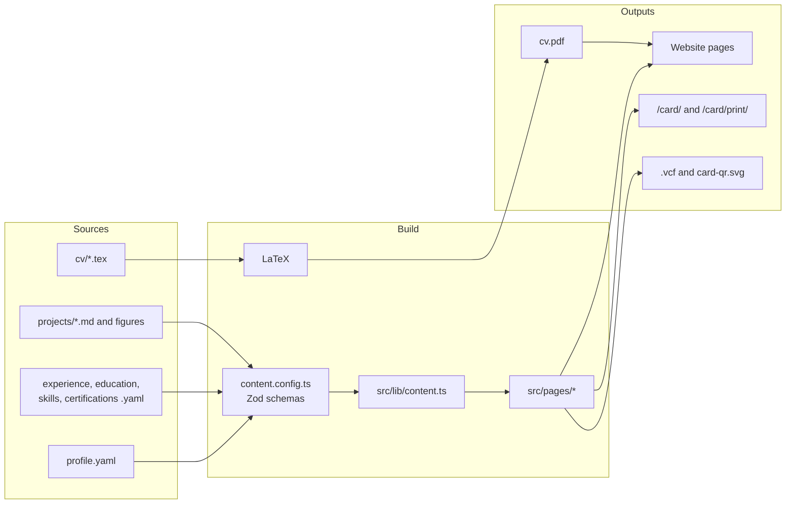
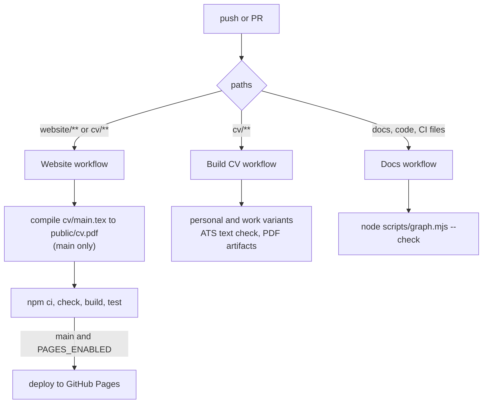

# System architecture

## Repository layout

| Path | What | Notes |
|---|---|---|
| `website/` | Astro 7 site, also the name card | Node 22.12+ (CI uses 24). Own `README.md` for running and editing |
| `website/src/data/*.yaml` | Profile, experience, education, skills, certificates | Validated by `src/content.config.ts` |
| `website/src/content/projects/*.md` | One file per project; the file name is the URL slug | Front matter is the datasheet, the body is Markdown |
| `website/src/assets/` | Photos and project figures (PNG) | Resized to AVIF/WebP at build time |
| `website/scripts/` | Figure guard, screenshots, measurements, OG image | Run with `node scripts/<name>.mjs` from `website/` |
| `website/tests/site.spec.ts` | Playwright tests, desktop and phone | Against the built site (`astro preview`) |
| `cv/` | LaTeX CV, one file per section | `main.tex` inputs the others; `config.sty` holds layout, metadata, the two email addresses |
| `docs/` | Documentation and the knowledge graph | Index: [docs/README.md](../README.md) |
| `scripts/graph.mjs` | Builds and checks the knowledge graph | Node built-ins only, no install needed |
| `design/prototype/` | v3 vanilla-JS prototype | History only, not built or deployed |
| `.github/workflows/` | CI: Website, Build CV, Docs | See below |

## Data flow

Two facts matter most:

1. **Website, card and vCard share one source.** `profile.yaml` feeds the home hero, the About page, the footer, the name card, the print card, the vCard and the command palette. Change it once.
2. **The CV does not read the YAML.** It repeats many of the same facts in LaTeX. They must be kept in sync by hand: see [sources-of-truth.md](sources-of-truth.md).

## Build and deploy

| Workflow | Triggers | Does |
|---|---|---|
| `website.yml` | Push to `main` touching `website/**`, `cv/**` or the workflow; PRs touching `website/**`; manual | On `main`: compiles the CV into `public/cv.pdf`. Always: `npm ci`, `npm run check` (types, content, figure metadata), `npm run build`, Playwright tests. On `main` with `PAGES_ENABLED=true`: deploys `website/dist` to Pages |
| `build-cv.yml` | Push touching `cv/**` or the workflow; PRs touching `cv/**`; manual | Builds both CV variants, checks that an ATS can extract key words and the email, uploads the PDFs |
| `docs.yml` | Push and PRs touching docs, `CLAUDE.md`, `README.md`, `scripts/`, `website/src/`, `cv/` or workflows | Fails if the knowledge graph is stale or a doc link or `covers:` path is broken |

**Merging to `main` publishes.** A merged PR that touches `website/` or `cv/` redeploys the public site within a few minutes.

## Base path and URLs

The site is a GitHub Pages project site, so every URL lives under `/Personal-Profile-Portfolio/`. `astro.config.mjs` reads `SITE_URL` and `SITE_BASE` (defaults: `https://dvez373.github.io`, `/Personal-Profile-Portfolio`). In code, always build links with `url()` from `src/lib/url.ts`, never with a hard-coded `/`. A custom domain needs `SITE_BASE=/` and a reprint of the name card, because the QR encodes the full URL.

## Runtime behaviour

The site is static HTML with small plain-TypeScript scripts (about 9 to 11 KB of JavaScript per page). No UI framework runs in the browser. Page transitions use Astro's `ClientRouter`, so every script re-initialises on `astro:page-load`. Details: [website architecture](../website/architecture.md).
