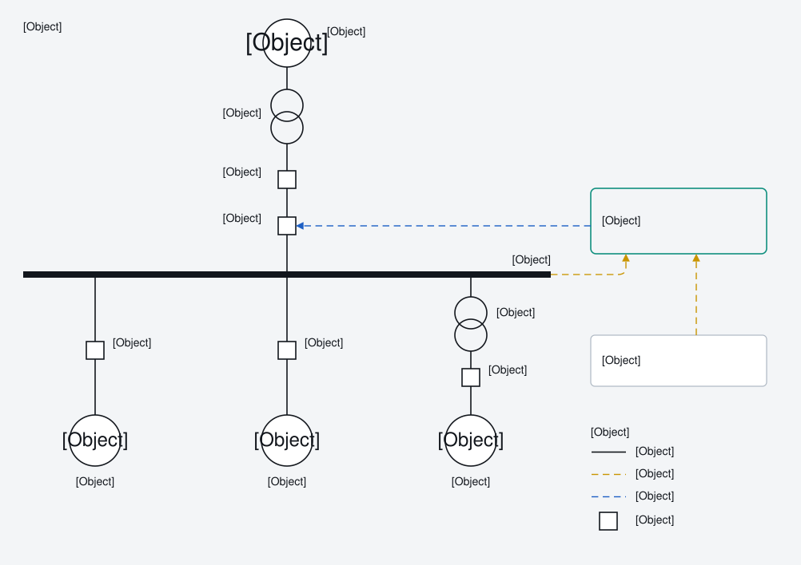

# Project overview

One repository, one person, three products. Together they make Devin Ezekiel Purba's professional profile.

| Product | What a visitor gets | Source | Output |
|---|---|---|---|
| **Website** | Portfolio: home, experience, education, projects (8 client case studies, 3 academic), skills, about | `website/` (Astro 7, TypeScript) | Static site on GitHub Pages: <https://dvez373.github.io/Personal-Profile-Portfolio/> |
| **CV** | ATS-friendly two-page CV, personal-email and work-email variants | `cv/` (LaTeX) | `cv.pdf` on the website ("Download CV"); both variants as CI artifacts |
| **Name card** | Phone card with save-contact, share and QR; print layout; vector QR; vCard | `website/src/pages/card/`, `card-qr.svg.ts`, `devin-ezekiel-purba.vcf.ts` | `/card/`, `/card/print/`, `/card-qr.svg`, `/devin-ezekiel-purba.vcf` |

The name card is part of the website build. The CV is built separately but is published through the website.

## Audience and purpose

- **Recruiters and hiring managers**: should understand who Devin is and what he has built within one screen, and be able to download the CV.
- **Engineering clients and peers**: case studies show real, anonymised power-system work with figures.
- **In person**: the name card QR opens `/card/`, which saves the contact in one tap.

## Status (2026-10-14)

- Website v5 is live: 8 anonymised client case studies, theme filters, design revision R1 to R17. Audit 19/20, critique 25/32 ([v5 plan](../website/07-v5-plan.md) §2.4).
- CV: Power System Engineer entry in STAR form, no locations, two pages.
- Name card: live since [PR 8](https://github.com/DvEz373/Personal-Profile-Portfolio/pull/8).
- Not yet done: the private name scan on `main` (Devin's PC only, see [publishing rules](publishing-rules.md)).

## Where to go next

| You want to | Read |
|---|---|
| Understand how the parts connect | [architecture.md](architecture.md) |
| Change a fact (job, phone, project) | [sources-of-truth.md](sources-of-truth.md), then [runbooks.md](runbooks.md) |
| Know what may be published | [publishing-rules.md](publishing-rules.md) |
| Know why something is the way it is | [decisions.md](decisions.md) |
| Work on the website code | [../website/architecture.md](../website/architecture.md) |
| Work on the CV | [../cv/reference.md](../cv/reference.md) |
| Work on the name card | [../card/reference.md](../card/reference.md) |
| Find what depends on a file | [../graph/README.md](../graph/README.md) (`node scripts/graph.mjs query <path>`) |
